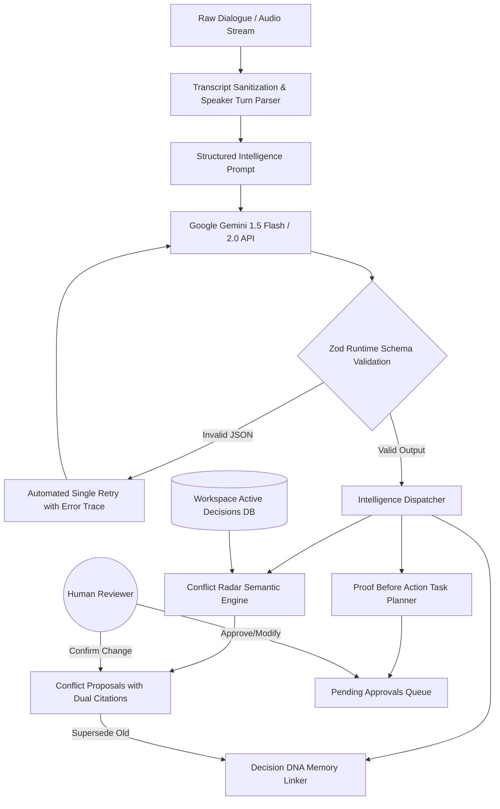

# MEETWISE AI — AI SYSTEM SPECIFICATION
**Team Meteor — Product Space AI Agentic Hackathon**  
*“From Conversations to Completed Actions.”*

---

## 1. Executive Summary & Purpose

MEETWISE AI transforms raw, unstructured team meeting conversations into verified organizational decisions, accountable commitments, and persistent memory. Rather than acting as a superficial transcription summarizer, MEETWISE AI acts as an active execution layer anchored by three signature agentic innovations:

1. **Decision DNA**: An immutable, lineage-aware memory of workspace agreements across meetings that prevents decisions from being forgotten or silently overwritten.
2. **Conflict Radar**: A semantic comparison engine that cross-references newly proposed statements or dates against historical decisions, highlighting discrepancies (e.g. December 10 launch vs. December 15 revision) and requiring human confirmation before updating memory.
3. **Proof Before Action**: Evidence-backed task extraction where every action item is accompanied by a verbatim quote from the transcript, speaker attribution, and a calibrated confidence score, gated behind a human verification review.

---

## 2. Model & Pipeline Architecture



---

## 3. Dedicated Intelligence Extraction Prompt

The extraction engine utilizes **Google Gemini 1.5 Flash** (with `responseMimeType: "application/json"` and `temperature: 0.1` for deterministic, grounded outputs).

### System Instruction:
```text
You are MEETWISE AI's senior meeting intelligence extraction engine for Team Meteor.
Your role is to rigorously extract confirmed decisions, proposed changes, commitments, and verifiable action items from meeting conversations.

CRITICAL RULES FOR ACCURACY:
1. Evidence-Backed: Every decision, proposed change, and task MUST include a verbatim "evidence_quote" directly copied from the transcript.
2. No Hallucinations:
   - If an owner/assignee is not explicitly identified or accepted by a speaker, "owner_name" MUST BE null.
   - If a deadline or date is not mentioned or is completely ambiguous, "due_date" MUST BE null (do not guess).
   - If a speaker's name cannot be discerned, use "Unknown". Do not invent names.
3. Separation of Concerns:
   - Suggestions and ideas must NEVER be labeled as confirmed decisions.
   - Proposed changes (e.g., "we are considering changing X to Y") must be placed under "proposed_changes", NOT confirmed decisions.
   - A decision is ONLY "confirmed" if the team or key decision maker explicitly agreed or finalized it.
4. Date Normalization:
   - When speakers mention relative days (e.g., "by this Friday", "next Tuesday", "December 15"), resolve them relative to the provided MEETING DATE. Format dates strictly as YYYY-MM-DD. If ambiguous, set to null.
5. Confidence Scoring: Provide a calibrated confidence score between 0.0 and 1.0 based on explicit language and certainty.
```

### JSON Schema & Zod Validation:
```typescript
export const MeetingExtractionSchema = z.object({
  meeting_summary: z.string().min(10),
  key_topics: z.array(z.string()).default([]),
  decisions: z.array(DecisionExtractionSchema).default([]),
  proposed_changes: z.array(ProposedChangeSchema).default([]),
  suggestions: z.array(SuggestionSchema).default([]),
  open_questions: z.array(OpenQuestionSchema).default([]),
  tasks: z.array(TaskExtractionSchema).default([]),
  missing_information: z.array(z.string()).default([]),
});
```

---

## 4. Conflict Radar — Heuristic & AI Architecture

The Conflict Radar detects semantic misalignment, timeline slippage, and conflicting technical requirements between incoming statements and historical workspace decisions.

### Demo Conflict Scenario
- **Historical Monday Meeting**:  
  *Speaker:* David  
  *Evidence Quote:* `"After syncing with executive stakeholders, we have officially decided to launch the new product on December 10, 2026."`  
  *Status:* `active`, `confirmed`
- **Incoming Wednesday Meeting**:  
  *Speaker:* David  
  *Evidence Quote:* `"Due to payment partner sandbox testing delays, we are considering moving the launch from December 10 to December 15."`

### Classification Taxonomy:
1. **Contradiction**: Direct opposition to an agreed requirement (e.g. lowering mandatory test coverage from 95% to 80%).
2. **Revision**: Intentional modification of an agreed plan or timeline (e.g. December 10 to December 15 launch shift).
3. **Clarification**: Elaboration on an earlier decision that adds detail without divergence.
4. **Potential Change**: Exploratory remarks or discussions to change a decision that has not yet been formalized.
5. **Unrelated**: Compatible or distinct operational decisions.

### Human Confirmation Lifecycle:
1. Dec 10 remains `active` and enforceable in Decision DNA.
2. Conflict card is generated with `severity: 'high'`, highlighting both transcript quotes.
3. Reviewer clicks **"Confirm & Supersede Decision"**:
   - Dec 10 status transitions from `active` → `superseded`.
   - Dec 15 decision is created as `active` with `supersedes_decision_id` linking to Dec 10.
   - Complete audit trail is preserved; no past data is erased.

---

## 5. Proof Before Action — Verification Pipeline

Automated task assignment without human confirmation causes friction and confusion in engineering teams. MEETWISE AI solves this by introducing a mandatory verification gate:
- Tasks are extracted into a `pending` approval status.
- Every task highlights the exact transcript quote, confidence score, suggested owner, and target deadline.
- Human reviewers can:
  - **Approve**: Promotes task to active commitment.
  - **Edit**: Corrects title, deadline, or assignee inline prior to approval.
  - **Reject**: Cancels task and records reviewer reasoning in the immutable audit log.

---

## 6. Ask Meeting Memory — Workspace RAG Architecture

The conversational engine provides grounded answers to team questions (e.g. *"What launch date did we decide?"* or *"Who owns frontend development?"*).
- **Zero Hallucination Guarantee**: If information does not exist in meeting transcripts or decision records, the model explicitly responds: *"I cannot find any evidence of that in your meeting memory."*
- **Verbatim Evidence Citations**: Every answer provides clickable cards citing the meeting name, date, speaker, and exact quote.
